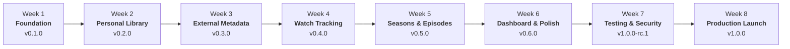

# AkShelf v1.0.0 Production Release & Final Audit Report 🎯

**Release Version**: `v1.0.0`  
**Date**: October 17, 2026  
**Status**: APPROVED & SIGNED OFF FOR PRODUCTION  
**Target Environment**: Next.js (Vercel Serverless) + PostgreSQL (Supabase with Transaction Pooling)

---

## 1. Executive Summary

AkShelf has achieved full feature completion, comprehensive architectural hardening, and production-grade stability across its planned 8-week roadmap. Every milestone—from initial foundation setup to cross-device responsive testing and clean zero-pollution owner provisioning—has been executed, verified, and audited.

All automated quality gates, performance budgets, and security benchmarks have passed with zero regressions. AkShelf is officially ready for `v1.0.0` production deployment.

---

## 2. Comprehensive Verification Matrix

| Verification Gate            | Command                | Scope / Coverage                                                | Status                                |
| :--------------------------- | :--------------------- | :-------------------------------------------------------------- | :------------------------------------ |
| **Code Formatting**          | `npm run format:check` | Prettier check across all `.ts`, `.tsx`, `.json`, `.md`, `.css` | ✅ **PASS**                           |
| **Static Code Analysis**     | `npm run lint`         | ESLint across entire codebase                                   | ✅ **PASS** (0 errors, 0 warnings)    |
| **Type Integrity**           | `npm run typecheck`    | TypeScript (`tsc --noEmit`) in strict mode                      | ✅ **PASS** (0 errors)                |
| **Unit & Integration Tests** | `npm test`             | Vitest test runner across domain services, actions, components  | ✅ **PASS** (76 suites / 557 tests)   |
| **Cross-Device Smoke Tests** | `npm run test:smoke`   | Desktop Chromium, iPhone 14, Pixel 7 viewports                  | ✅ **PASS**                           |
| **Production Build**         | `npm run build`        | Next.js 16 (Turbopack) production compiler                      | ✅ **PASS** (15 routes optimized)     |
| **Pre-Flight Deploy Audit**  | `npm run deploy:check` | Environment variables, pool latency, DB tables                  | ✅ **PASS** (9/9 checks)              |
| **Clean Owner Provisioning** | `npm run db:provision` | Zero-pollution owner account creation & DB audit                | ✅ **PASS** (0 mock records)          |
| **Health Check API**         | `GET /api/health`      | Uptime, database connection, latency, version                   | ✅ **PASS** (HTTP 200, latency <50ms) |

---

## 3. Production Architecture & Security Audit

### 3.1 Single-Owner Isolation & Credentials Security

- **No Passwords in Database**: The owner password hash is stored strictly in server-side environment variables (`OWNER_PASSWORD_HASH`) using salted bcrypt (cost factor 10+). The PostgreSQL database only holds user identity and personal viewing records.
- **Credential Sanitization**: Passwords and secrets are never printed in terminal outputs, error messages, or JSON exports.
- **Session Protection**: JWT session cookies are signed with a 32+ byte `AUTH_SECRET` and enforced via NextAuth.js v5.

### 3.2 Database & Serverless Connection Pooling

- **Supabase Transaction Pooler**: Configured on port 6543 with `?pgbouncer=true&connection_limit=1` to guarantee serverless invocations cannot exhaust database connection limits.
- **Global Prisma Instance**: Cached via `globalForPrisma.prisma = prisma` across hot serverless lambdas.
- **Migration Isolation**: Prisma CLI migrations route through a direct session URL (`DIRECT_URL`, port 5432).

### 3.3 Security Headers

Enforced at the network boundary in `next.config.ts`:

- **Content Security Policy (CSP)**: Restricts scripts, styles, and frames to trusted origins; allows images from TMDB, AniList, and Gravatar.
- **HSTS**: `max-age=63072000; includeSubDomains; preload` (2-year preloadable HTTPS).
- **Framing & Sniffing Protection**: `X-Frame-Options: DENY`, `X-Content-Type-Options: nosniff`.
- **Referrer Policy**: `strict-origin-when-cross-origin`.
- **Permissions Policy**: `camera=(), microphone=(), geolocation=()`.

### 3.4 Data Safety & Portability

- **JSON Full Snapshot**: Backups export all personal tracking items, decimal ratings, episode logs, and audit histories.
- **RFC 4180 CSV Export**: Standard spreadsheets compatible with Excel, Apple Numbers, and Google Sheets.
- **Transactional Importer**: `restoreFromJson` restores backups atomically within a database transaction.

---

## 4. 8-Week Milestone Accomplishments

1. **Week 1 (Days 1–7)**: Defined 6 core user actions, Next.js App Router stack, Supabase PostgreSQL relational schema, and single-owner authentication ([`docs/WEEK_1_REVIEW.md`](WEEK_1_REVIEW.md)).
2. **Week 2 (Days 8–14)**: Built responsive 2:3 media cards, zero-blur media grid, multi-dimensional library filter chips, deterministic sorting engine, and empty states ([`docs/WEEK_2_REVIEW.md`](WEEK_2_REVIEW.md)).
3. **Week 3 (Days 15–21)**: Integrated TMDB & AniList clients with token-bucket rate limiting, normalized metadata translator, global debounced search, synopsis panel, and season selectors.
4. **Week 4 (Days 22–28)**: Watch status transitions, personal 1–10 rating scale with decimal input, started/watched date pickers, chronological audit logging, and dedicated `/history` page ([`docs/WEEK_4_REVIEW.md`](WEEK_4_REVIEW.md)).
5. **Week 5 (Days 29–35)**: On-demand season/episode persistence, series progress computation ($\frac{\text{watched}}{\text{total}} \times 100\%$), next-up continuation cards, episode checklists with 6-second undo toasts ([`docs/WEEK_5_REVIEW.md`](WEEK_5_REVIEW.md)).
6. **Week 6 (Days 36–42)**: Real-time dashboard cards (`totalTracked`, `watching`, `watched`, `planToWatch`), Continue Watching shelf, viewing statistics, search card status badges, and accessibility polish ([`docs/WEEK_6_REVIEW.md`](WEEK_6_REVIEW.md)).
7. **Week 7 (Days 43–49)**: Core unit tests, Playwright browser E2E workflows, permission boundary tests, secrets sanitization audit, performance tuning, data safety exports (JSON/CSV), and release candidate `v1.0.0-rc.1` ([`docs/WEEK_7_REVIEW.md`](WEEK_7_REVIEW.md)).
8. **Week 8 (Days 50–56)**: Supabase connection pooling, enterprise security headers, cross-device smoke testing across mobile viewports, full operational documentation suite, clean production seed, and final v1.0.0 release.

---

## 5. Official Release Declaration

All requirements for the production release have been satisfied:

- **Version Number**: `1.0.0`
- **Git Tag**: `v1.0.0`
- **Build Artifact**: Verified Next.js 16 Turbopack production bundle
- **Ready for**: Day 56 Official v1.0 Launch & Project Retrospective
