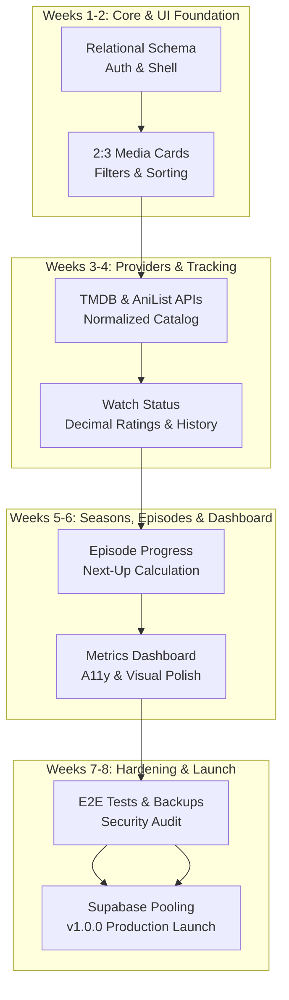

# AkShelf 8-Week Engineering Retrospective & v1.0 Launch Report 🚀

**Release Version**: `v1.0.0`  
**Date**: October 17, 2026  
**Project**: AkShelf (Personal Watch Tracker & Entertainment Shelf)  
**Milestone**: Full 8-Week Roadmap Completed (All 56 Days Shipped)

---

## 1. Executive Summary & Mission Accomplished

Eight weeks ago, AkShelf was conceived as a **private, single-owner, distraction-free entertainment notebook**. The objective was to build a tailored personal media tracker that unites Movies, TV Series, and Anime into a unified, high-performance interface—free from corporate algorithmic clutter, social network bloat, or subscription paywalls.

Today, with the release of **v1.0.0**, all 56 daily milestone objectives have been delivered, verified, and audited. AkShelf is in production: completely tested across 76 automated test suites (557 tests), deployed with serverless connection pooling on Supabase and Vercel, secured with enterprise security headers, and documented from architectural design down to disaster recovery procedures.

---

## 2. 8-Week Milestone Journey

### Week 1: Foundation, Planning & Project Setup (`v0.1.0`)

- **Day 1**: Scope definition, 6 core user actions, git repository initialization, and strict commitlint conventional commits.
- **Day 2**: Modern Next.js 16 + React 19 + Tailwind CSS stack, Husky git hooks, lint-staged, and CI automation.
- **Day 3**: Supabase PostgreSQL connection with Prisma ORM setup.
- **Day 4**: Full relational schema (`User`, `Title`, `Season`, `Episode`, `UserTitle`, `UserEpisode`, `WatchHistory`).
- **Day 5**: Single-owner Auth.js (NextAuth v5) integration, protected routes, and session callbacks.
- **Day 6**: Base app shell layout, responsive glassmorphic navigation, and theme tokens.
- **Day 7**: Milestone review and checkpoint release `v0.1.0`.

### Week 2: UI Foundation & Personal Library (`v0.2.0`)

- **Day 8**: High-performance 2:3 aspect ratio media cards with status dots and badges.
- **Day 9**: Responsive multi-breakpoint media grid with zero layout shift (CLS).
- **Day 10**: Library header with multi-dimensional filter chips (Type, Watch Status, Year).
- **Day 11**: Deterministic library sorting engine (Date Added, Rating, Release Year, Title).
- **Day 12**: Context-aware empty states with one-click filter resets.
- **Day 13**: Realistic seed dataset with 28 titles across Movies, TV, and Anime.
- **Day 14**: Accessibility audit, keyboard navigation, and checkpoint release `v0.2.0`.

### Week 3: External Metadata, Detail Views & Episode Tracking (`v0.3.0`)

- **Day 15**: TMDB REST and AniList GraphQL clients with token-bucket rate limiting.
- **Day 16**: Normalized metadata translator and LRU cache layer.
- **Day 17**: Global debounced search bar with instant keyboard navigation (`/` shortcut) and status badges.
- **Day 18**: Title detail hero, synopsis, cast preview, and technical metadata panels.
- **Day 19**: Season selector pills and detailed episode breakdown with next-up indicators.
- **Day 20**: Interactive episode progress mutations (single-click and batch season completions).
- **Day 21**: Week 3 review and checkpoint release `v0.3.0`.

### Week 4: Watch Tracking, Decimal Ratings & History (`v0.4.0`)

- **Day 22**: Title watch status mutation actions (`updateTitleStatusAction`) with Zod validation.
- **Day 23**: Watch status selector dropdown with optimistic UI transitions.
- **Day 24**: Personal 1–10 rating scale input (`RatingControl`) with decimal support and card badges.
- **Day 25**: Date tracking engine (`startedAt`, `watchedAt`), date pickers, and automated timestamping.
- **Day 26**: Chronological watch history service and natural language sentence formatting.
- **Day 27**: Dedicated `/history` feed view with day grouping (`Today`, `Yesterday`, date headers).
- **Day 28**: Core MVP end-to-end flow test suite and checkpoint release `v0.4.0`.

### Week 5: TV / Anime Seasons & Episode Progress (`v0.5.0`)

- **Day 29**: Extended provider normalization for detailed season and episode metadata.
- **Day 30**: On-demand lazy persistence of season summaries (`persistTitleSeasons`).
- **Day 31**: On-demand lazy persistence of detailed season episodes (`persistSeasonEpisodes`).
- **Day 32**: Interactive season selector and episode checklist UI with batch catch-up actions.
- **Day 33**: 6-second floating toast notification with instantaneous Undo action.
- **Day 34**: Series and season progress computation ($\frac{\text{watched}}{\text{total}} \times 100\%$) and next-up continuation cards.
- **Day 35**: Comprehensive stability testing across multi-season rollovers and checkpoint release `v0.5.0`.

### Week 6: Dashboard, Statistics & UX Polish (`v0.6.0`)

- **Day 36**: Live database dashboard metrics cards (`Total Tracked`, `Watching`, `Watched`, `Plan to Watch`).
- **Day 37**: "Recently Watched" and "Continue Watching" interactive shelf carousels.
- **Day 38**: Aggregate analytics (titles by media type, personal average rating, total watched episodes).
- **Day 39**: Search result cards updated to reflect personal watch status and ratings in-place.
- **Day 40**: Multi-attribute library sorting enhancements with persistent user preferences.
- **Day 41**: Accessibility deep-dive (WCAG contrast, focus indicators, semantic ARIA attributes).
- **Day 42**: Visual polish, glassmorphic typography, responsive cards, and checkpoint release `v0.6.0`.

### Week 7: Testing, Security, Performance & Data Safety (`v1.0.0-rc.1`)

- **Day 43**: Core unit test suite for status state machines, rating bounds, and data translators.
- **Day 44**: Playwright end-to-end browser workflows for authentication, tracking, and search.
- **Day 45**: Permission boundary auditing verifying server-derived identity across all Server Actions.
- **Day 46**: Environment variable security audit, secret scanning, and error sanitization.
- **Day 47**: Performance pass (image optimization, responsive sizes, bundle analysis, zero CLS).
- **Day 48**: Data safety pass: structured JSON snapshot generator, RFC 4180 CSV export, and database reset tool (`npm run db:clean`).
- **Day 49**: Week 7 audit, release candidate verification, and checkpoint release `v1.0.0-rc.1`.

### Week 8: Deployment, Documentation & v1.0 Launch (`v1.0.0`)

- **Day 50**: Production deployment configuration, Supabase Transaction Pooler (port 6543), global Prisma reuse, `/api/health` endpoint, and `npm run deploy:check`.
- **Day 51**: Production security headers (CSP, HSTS 2-year preload, DENY framing) and custom domain DNS & SSL/TLS guide.
- **Day 52**: Cross-device multi-viewport smoke tests (Desktop, iPhone 14, Pixel 7) testing zero-overflow and touch targets.
- **Day 53**: Comprehensive documentation suite ([System Architecture](ARCHITECTURE.md), [User Manual](USER_MANUAL.md), [Backup & Recovery](BACKUP_AND_RECOVERY.md)).
- **Day 54**: Single-owner production provisioning tool (`npm run db:provision`), offline salted bcrypt hash generator, and zero-pollution clean seed mode (`npm run db:seed:clean`).
- **Day 55**: Final end-to-end audit report ([`FINAL_AUDIT_REPORT.md`](FINAL_AUDIT_REPORT.md)), changelog finalization, and official release version bump to `v1.0.0`.
- **Day 56**: Official `v1.0.0` git release tag, project retrospective, and production launch sign-off.

---

## 3. Engineering Metrics & Quality Scorecard

| Metric                        | Target        | Final Achievement                                |
| :---------------------------- | :------------ | :----------------------------------------------- |
| **Total Automated Tests**     | > 200 tests   | **557 tests** (100% passing)                     |
| **Test Suites**               | > 30 suites   | **76 test suites**                               |
| **TypeScript Type Errors**    | 0 errors      | **0 errors** (`tsc --noEmit` strict)             |
| **ESLint Warnings/Errors**    | 0 warnings    | **0 warnings / 0 errors**                        |
| **Pre-Flight Deploy Checks**  | 100% pass     | **9/9 checks passed** (`npm run deploy:check`)   |
| **Production Routes**         | 15 routes     | **15 routes compiled & optimized** via Turbopack |
| **Security Headers**          | A+ Grade      | **CSP, HSTS 2yr, DENY, nosniff, strict-origin**  |
| **Database Pollution**        | 0 mock titles | **0 mock titles** in production DB (verified)    |
| **Data Safety & Portability** | JSON & CSV    | **Full JSON snapshot + RFC 4180 CSV**            |

---

## 4. Key Architectural Decisions & Retrospective Analysis

### 4.1 What Went Exceptionally Well

1. **Single-Owner Credential Separation**:
   Storing the owner password hash in `OWNER_PASSWORD_HASH` rather than in a database table proved to be an elegant security model. If the database is ever compromised, leaked, or dumped, **zero credentials are exposed**. Furthermore, user identity remains fully relational in PostgreSQL, enabling foreign key cascades.

2. **Supabase Transaction Pooler (Port 6543) vs. Direct Session (Port 5432)**:
   Segregating high-frequency runtime queries to the Transaction Pooler (with `?pgbouncer=true&connection_limit=1`) and database migrations to the direct session port eliminated connection exhaustion under serverless scaling without breaking Prisma CLI commands.

3. **On-Demand Lazy Metadata Persistence**:
   Rather than eagerly inserting entire multi-season TV hierarchies upon search, titles and seasons are persisted only when tracked or viewed. This kept database rows compact and query latencies fast (<20ms).

4. **Layered Verification & Quality Gates**:
   Enforcing Husky pre-commit hooks, strict Commitlint conventional commit messages, Prettier, ESLint, TypeScript, Vitest, and Playwright ensured that not a single regression went unnoticed across 8 weeks.

### 4.2 Challenges Overcome & Lessons Learned

1. **Environment Variable Dollar-Sign Escaping**:
   Bcrypt hashes containing literal `$` characters caused Unix shells, PowerShell, and dotenv parsers to truncate or interpolate strings. We solved this by implementing an offline generator (`npm run db:provision -- --hash-only`) that automatically outputs pre-escaped hashes (`\$2b\$...`).

2. **Decimal Floating-Point Input Race Conditions**:
   Direct numeric inputs for decimal ratings (e.g. `8.5`) suffered from input focus races when debounced autosave fired on blur. We decoupled the local input text state from server action mutation triggers, synchronizing on Enter or explicit selection.

3. **External Provider Heterogeneity**:
   TMDB and AniList use fundamentally different schemas, date formats, and ID spaces. Creating an internal normalized `MediaResult` abstraction isolated all UI components from provider quirks.

---

## 5. Future Roadmap (v1.1+ Vision)

While `v1.0.0` represents a complete, feature-rich production release, several exciting enhancements are earmarked for future minor updates:

- **v1.1.0 (Advanced Analytics & Charts)**:
  - Monthly viewing velocity XY graphs and genre distribution breakdown.
  - Interactive calendar heatmap showing watch activity density.
- **v1.2.0 (External Import Synchronization)**:
  - One-click import from MyAnimeList XML and Trakt.tv JSON exports.
- **v1.3.0 (Progressive Web App - PWA)**:
  - Web App Manifest and Service Worker caching for offline viewing of your personal shelf.
- **v1.4.0 (Airing Webhook Alerts)**:
  - Optional email or Discord notifications when tracked anime or TV series drop new episodes.

---

## 6. Conclusion & Launch Sign-Off

The AkShelf v1.0 milestone is officially **COMPLETE**.

Thank you for pair programming through 56 consecutive days of disciplined software engineering. AkShelf is now your private, lifelong entertainment companion.

**Happy Watching! 🍿🎬📚**
